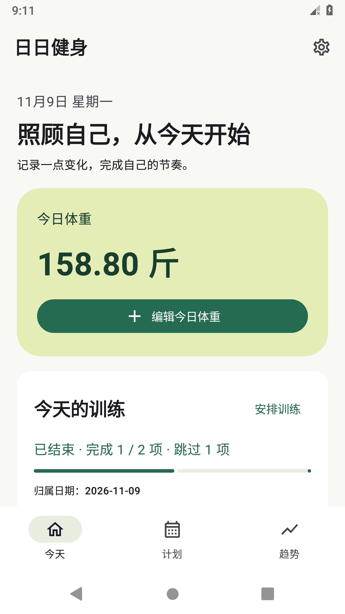
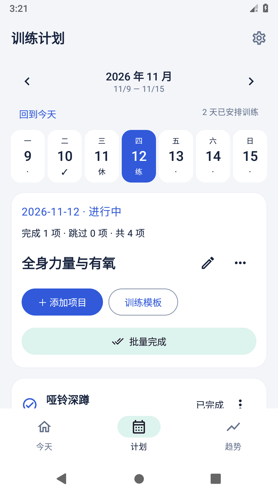
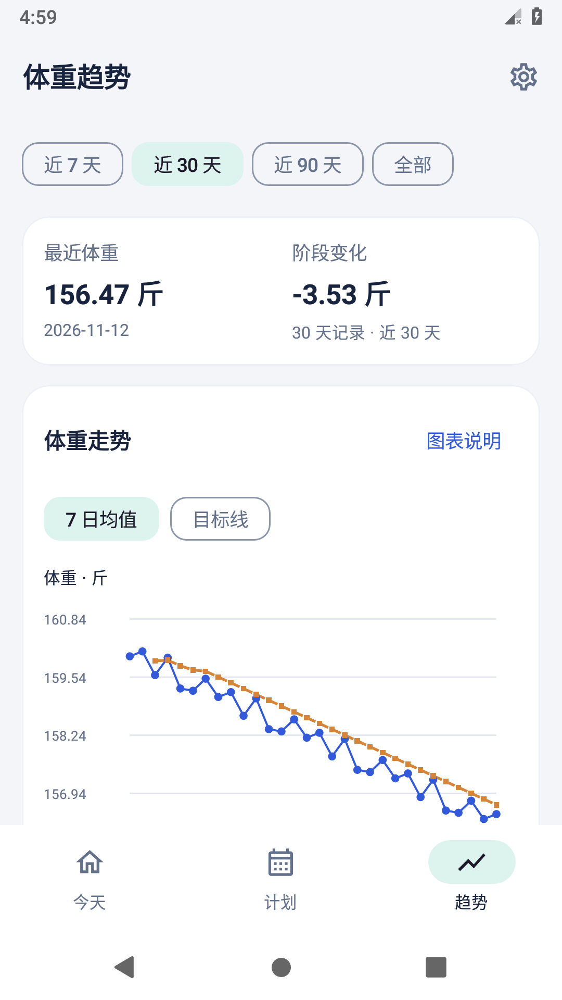
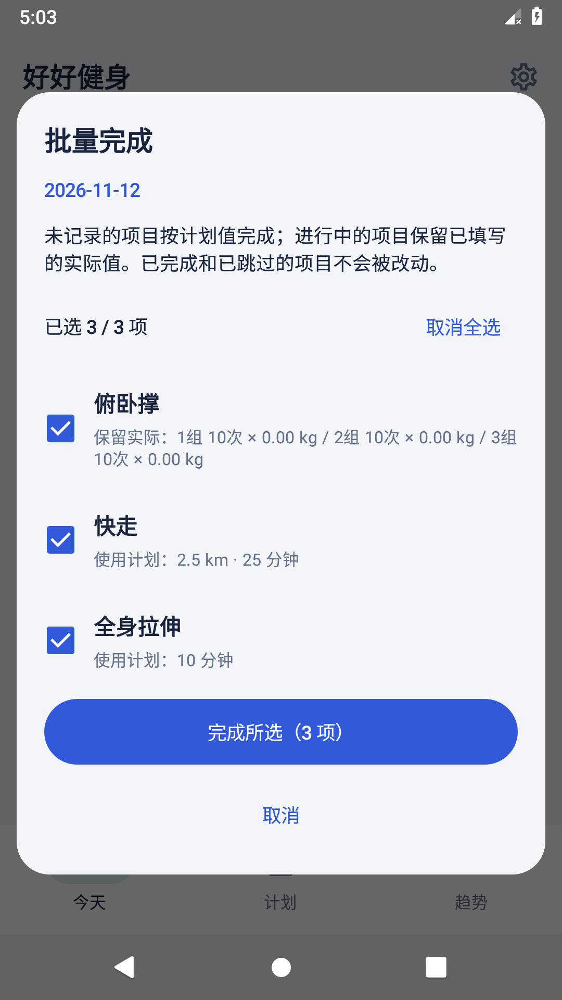
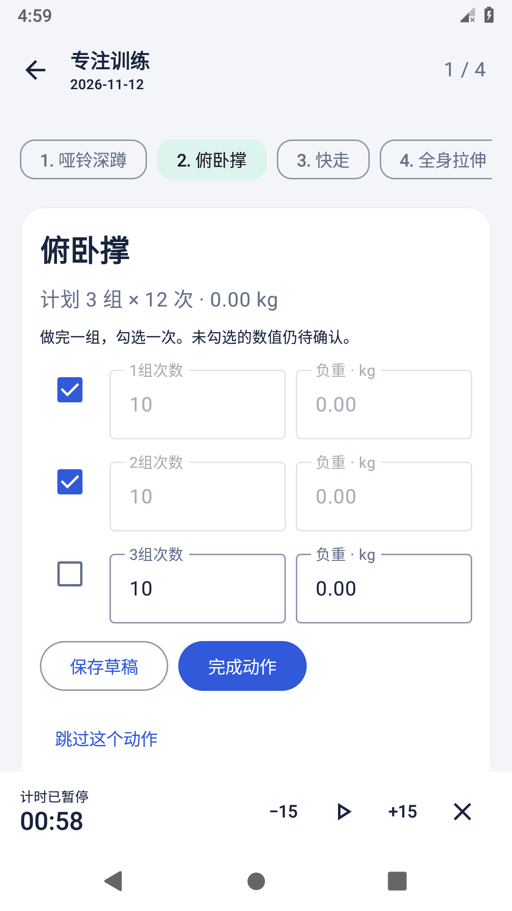
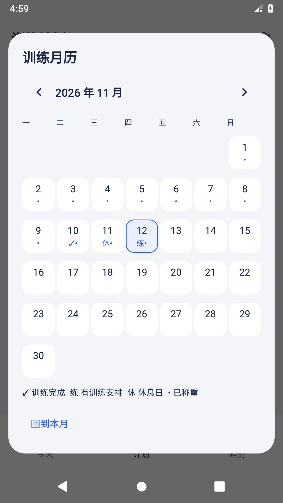

# 好好健身

个人自用的原生 Android 健身 App。记录每天体重、安排训练，并查看真实测量与 7 日移动平均；无需注册，安装后可离线使用。

按 [个人健身 App 需求文档](docs/个人健身App需求文档.md) 实现，应用包名为 `com.xieqinglin.fitness`，当前版本为 `1.2.0` / `versionCode 6`，最低支持 Android 8.0（API 26）。可覆盖旧正式版本并保留记录。

## v1.2 日常使用更新

- 专注训练模式：逐组确认、草稿保存、恢复训练进度；休息倒计时固定底部，可暂停、增减时间或关闭自动计时。
- 快速录入：编辑体重自动选中数值、增减 0.1、主动沿用上次；支持斤和公斤的精确往返换算。
- 更快建计划：最近动作和常用项目搜索、正确带入记录类型、复用最近训练、完整月历选日。
- 页面记住筛选和位置；从设置返回原页面；长按桌面图标直接称重或训练。
- 跟随系统、浅色和深色主题；可选训练亮屏和轻触反馈。
- 可选称重和训练提醒，默认关闭；当天已称重或训练已无待完成项目时不重复提醒。
- 本机最近 8 个恢复点、体重和训练 CSV；完整备份升级为 v3，继续接受旧 v1/v2。

设计取舍、调研来源和具体行为见 [V1.2 体验优化与调研](docs/V1.2体验优化与调研.md)。

## v1.1 使用体验更新

- 今天页和计划页支持批量选择与完成，操作后可撤销；保留进行中的实际值，不覆盖已完成和已跳过项目。
- 称重录入框直接切换公斤与斤，自动换算并记住选择；体重和训练负重单位独立设置。
- 重新设计今天、计划、趋势及设置页面：移除宣传大标题，一周完整展示，统计摘要优先，目标线可切换。
- 同名同类型项目展示之前已完成的实际记录，填写时可主动复用。
- 设置显示本机最近成功导出时间；V1.1 的备份格式为 v2，当前格式及兼容性见下方说明。

本轮参考 Strong、Hevy、StrongLifts、FitNotes、Happy Scale 和 Google Fit 的官方资料，设计取舍见 [V1.1 优化与调研](docs/V1.1优化与调研.md)。

## 核心功能

| 页面 | 可用功能 |
| --- | --- |
| 今天 | 今日体重录入与编辑、标注真实日期的最近体重、当日训练进度、临时新增训练、实际值与完成/跳过记录、近 7 天小图 |
| 计划 | 周一开始的周视图、前后周切换、每日多项目、逐组次数及负重、时长与距离项目、排序、休息日、计划改期和日期复制 |
| 模板 | 新建、重命名、编辑、删除、从某天另存、追加或替换应用、逐日处理冲突的周复制 |
| 训练模式 | 逐组确认、草稿、动作切换、暂停与恢复休息计时、亮屏与轻触反馈 |
| 趋势 | 7/30/90 天及全部、日历日期横轴、缺失日断线、7 日移动平均、点击查询、统计摘要、历史编辑及训练日期入口 |
| 设置 | 独立体重与负重单位、目标、外观、可选提醒、备份、恢复点、CSV |

P0 功能及目标体重、CSV、可选提醒已实现。自动推荐、健康平台和多设备同步不在当前范围。

| 今天 | 计划 | 趋势 |
| --- | --- | --- |
|  |  |  |

截图来自 API 28 模拟器；其中记录为验收时主动导入的模拟数据，App 首次安装时没有内置记录。



| 专注训练 | 训练月历 |
| --- | --- |
|  |  |

## 安装使用

后续针对力量＋有氧混合使用的规划见 [后续优化方案](docs/后续优化方案.md)，配有 [技术审查与实验](docs/后续优化技术审查.md) 和 [实施顺序及验收清单](docs/后续优化验收清单.md)。这是待实施规划，当前安装包仍为上述 V1.2.0。

1. 将 `releases/fitness-1.2.0.apk` 下载到安卓手机；安装文件与校验说明见 [releases](releases/README.md)。旧版用户先导出备份，再直接覆盖安装，不要先卸载。
2. 按系统提示允许当前文件管理器或浏览器“安装未知应用”，打开 APK 安装。
3. 首页点击“记录今日体重”；到“计划”添加项目或创建模板。
4. 点击“开始 / 继续训练”进入逐组记录，或使用“批量完成”；具体修正与跳过仍可从项目进入。
5. 设置页定期导出备份，选择自己能找回的位置；更换手机前务必备份。

应用不申请网络、位置、相机、通讯录或广泛存储权限。仅主动启用提醒时申请通知权限，开机接收用于恢复已启用的提醒。不内置演示健康记录，不依赖首次联网下载内容。系统云备份与设备自动转移已禁用，数据迁移使用手动 JSON 备份。

**卸载或清除应用数据会删除本机记录。** 正式使用请一直安装相同发布签名的版本。Debug 包使用 `.debug` 后缀和独立数据空间，可与正式版同时安装。

## 开发与构建

工具链固定在版本目录与 Gradle Wrapper 中：

| 工具 | 版本 |
| --- | --- |
| JDK | 17 |
| Gradle / Android Gradle Plugin | 8.11.1 / 8.9.1 |
| Kotlin / Compose 编译插件 | 2.1.20 |
| Compose BOM / Material 3 | 2025.04.01 / BOM 管理 |
| Room / KSP | 2.7.1 / 2.1.20-1.0.32 |
| Android compileSdk / targetSdk | 35 / 35 |

使用 Android Studio 打开仓库根目录，安装 SDK Platform 35 与 Build Tools 35.0.0。Android Studio 会生成本机的 `local.properties`；命令行可自行配置：

```properties
sdk.dir=C:/Users/YOUR_NAME/AppData/Local/Android/Sdk
```

Windows PowerShell：

```powershell
.\gradlew.bat assembleDebug
.\gradlew.bat testDebugUnitTest lintDebug
.\gradlew.bat assembleDebugAndroidTest
# 已启动独立模拟器或连接测试手机后：
.\gradlew.bat connectedDebugAndroidTest
```

macOS / Linux：

```sh
chmod +x gradlew
./gradlew assembleDebug testDebugUnitTest lintDebug
./gradlew connectedDebugAndroidTest
```

首次**构建**需要联网下载 SDK、Gradle 和依赖；已安装的 App 核心功能不需要联网。Debug 输出为 `app/build/outputs/apk/debug/app-debug.apk`。

### 正式签名与更新

发布签名不随源码分发。复制 `keystore.properties.example` 为 `keystore.properties`，配置你自己的密钥位置、别名和密码，再运行：

```powershell
.\gradlew.bat assembleRelease
# 后续版本递增 versionCode，继续使用相同包名与发布密钥：
.\gradlew.bat assembleRelease -PappVersionCode=7
```

输出为 `app/build/outputs/apk/release/app-release.apk`；未配置发布签名时只生成 unsigned APK。`keystore.properties`、密钥和密码均已忽略，不要提交。请单独安全备份密钥及密码，丢失后无法为原安装包签署可覆盖升级的版本。正式升级前先导出 JSON，不要先卸载。

## 数据规则

- 每个日期一条体重，禁止未来日期。覆盖其他日期记录需明确确认，删除前确认。
- 体重及训练负重以整数克存储，即 kg 的 `0.001` 精度；kg/斤只在输入输出时换算。距离为 km，时长为秒。
- 7 日移动平均使用当日及此前 6 个日历日，至少 3 天有测量且当日有测量才生成趋势点。范围筛选在趋势计算后执行，不补零、不插值。
- 测量实线与均值虚线均只连接相邻日历日；设置目标后用另一种短虚线显示。差值采用中性正负号，避免 `-0.00`。
- 日期为固定 `YYYY-MM-DD` 归属键，时间戳带时区。训练表单明确显示归属日期，已打开的执行表单不会在午夜自动换日。
- 计划项目有独立 ID，实际值、名称和目标快照独立保存。修改目标保留实际；完成和跳过不同，全部跳过显示“已结束”。
- 替换计划保留已有实际记录关联的项目。已有实际记录时不能设为休息日，也不能直接删除关联项目；需要先在实际记录中明确删除，再操作计划。
- 无实际记录的计划可整体改期；已有实际记录则只复制尚未完成的目标，原日期历史保留。日期/周复制与模板应用都生成独立 ID，绝不复制执行状态。

## 备份与恢复

设置 → 导出完整 JSON → 系统文件选择器选择保存位置。文件含 `schemaVersion`、带时区的 `exportedAt`、各对象数量及完整 `data`，涵盖体重、计划、实际、模板和设置。

恢复流程：选择 JSON → 校验版本/类型/日期/数值/唯一性/关联/状态/数量 → 预览替换范围 → 用户确认 → 选择原数据安全备份位置 → 原备份成功写完 → 一个 Room 事务替换所有表。取消选择、非法文件或事务失败都不会部分覆盖原数据。新导出为 v3，支持导入 v1、v2 和 v3；单文件上限 32 MB，不做自动合并。v1 迁移单位设置，v1/v2 迁移已完成组标记；v3 不能交给旧版恢复。

CSV 供表格分析，不作为恢复格式。本机恢复点最多每分钟保存一次，保留最近 8 个；卸载会删除，不能替代外部备份。主题、提醒和计时偏好属于本机设置。

备份包含个人健康信息，文件未额外加密，请自行选择合适的存放位置。

## 项目结构

```text
app/src/main/java/com/xieqinglin/fitness/
  ui/                 Compose 页面、表单、Canvas 图表与主题
  presentation/       ViewModel、加载/保存状态、系统文件读写协调
  domain/             类型、校验、单位、统计与计划操作
  data/local/         Room 实体、DAO 与数据库
  data/repository/    业务写入、差量更新与恢复事务
  backup/             JSON 编解码和全量校验
app/schemas/          Room v1 数据库结构，后续升级必须保留并增加迁移
app/src/test/         JVM 业务与备份测试
app/src/androidTest/  Room 事务/约束与 Compose 流程测试
docs/                需求及验收记录
```

数据库不启用破坏性迁移。当前是首版 schema 1；将来改表必须增加版本、实现迁移并补充迁移测试。日期、关联项目等独立唯一索引使用明确的插入和更新，约束冲突会向上传递为保存失败。Compose 只消费统一业务序列，存储与文件操作在后台执行，保存成功只在持久化完成后提示。

## 验证与限制

测试命令、实测环境、验收覆盖及未验收事项见 [V1.2 验收记录](docs/V1.2验收记录.md)，历史记录见 [V1.1](docs/V1.1验收记录.md) 和 [v1](docs/V1验收记录.md)。GitHub Actions 包含单元测试、Lint、APK 构建以及 API 28 模拟器仪器测试，报告通过 workflow artifacts 保存。

当前版本验证结果以 V1.2 验收记录为准。目标真机性能、Android 13 及以上的通知授权、厂商省电和文件选择器仍需复核；不把模拟器结果当作目标手机实测结果。每日提醒受系统调度影响，应用内休息计时不承诺应用被系统结束后响铃。

## 参考与许可

技术方案参考 [Android 架构建议](https://developer.android.com/topic/architecture/recommendations)、[AGP 与 Gradle 兼容表](https://developer.android.com/build/releases/about-agp)、[Room 官方版本说明](https://developer.android.com/jetpack/androidx/releases/room) 与 [Kotlin Compose 编译插件说明](https://kotlinlang.org/docs/compose-compiler-migration-guide.html)。

本项目使用 [Apache License 2.0](LICENSE)。
