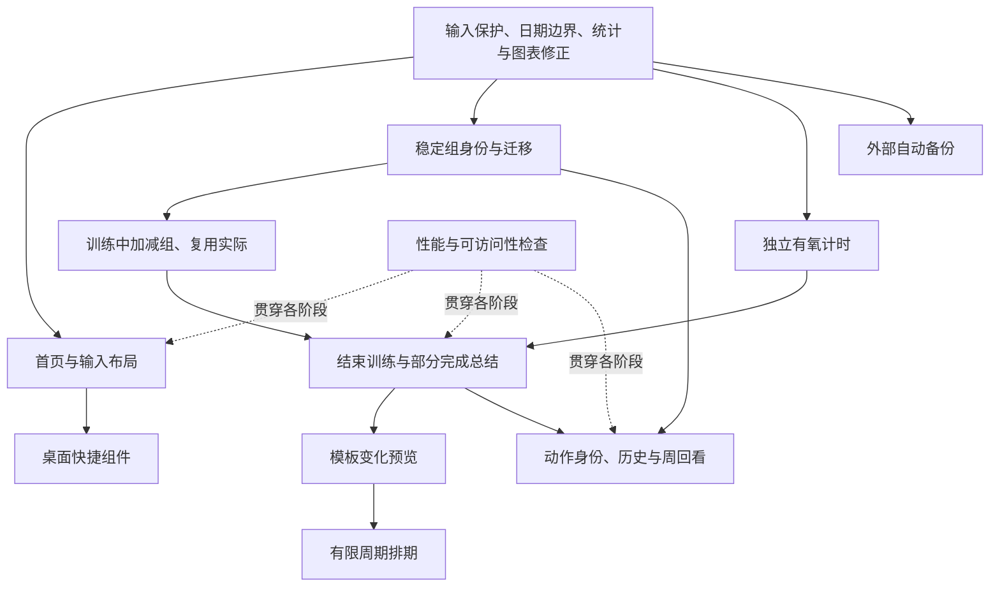

# 后续优化：实施顺序与验收清单

日期：2026 年 11 月 12 日  
状态：待实施需求；下列条目未因写入本文而成为已验收功能。

主方案见 [后续优化方案](后续优化方案.md)，现状证据见 [技术审查](后续优化技术审查.md)。场景以个人力量＋有氧混合记录为准，训练频次由用户自己设置。

## 1 建议实施顺序

这是依赖顺序，不表示已经启动多路并行开发。不增加账号、服务端或新权限来绕开本机状态问题。

## 2 V1.2.1：先修现有缺口

| 用例 | 操作 | 预期 |
| --- | --- | --- |
| FIX-01 | 普通实际录入修改数字后按系统返回或点外部 | 提示未保存；继续编辑保留输入；明确放弃才关闭 |
| FIX-02 | 修改完成状态、跳过原因，或把原数字清空后返回 | 都识别为修改；不能因输入暂时无效而误判未修改 |
| FIX-03 | 成功保存或明确点击取消 | 成功只在数据库写完后提示；取消按约定处理，不重复弹层 |
| FIX-04 | 已有 11-12 的合法记录，设备日期退回 11-11，再编辑其他合法历史项 | 存量日期不阻断保存，不自动移动历史；新增 11-12 的实际仍按当前日历规则拦截 |
| FIX-05 | 回拨/校准日期后再次生成恢复点 | 不因旧文件的未来修改时间永久跳过；保留限流与数量上限 |
| FIX-06 | 只有目标、只有 DRAFT、部分确认、DONE、SKIPPED，各建一个日期 | 日期列表、周统计、月历与说明使用约定口径；计划和纯草稿不能冒充完成 |
| FIX-07 | 从图表内部向上/下滑，再左右拖动 | 纵向滚动页面；横向选点；不出现只能从边缘滚动的陷阱 |
| FIX-08 | 全部历史跨两年、只有一个点、存在缺失日 | 年份明确；单点可看；缺失日不补零；均值不因切范围而变化 |

## 3 V1.3：完整混合训练流程

### 3.1 首页与称重

| 用例 | 操作 | 预期 |
| --- | --- | --- |
| HOME-01 | 首次安装进入，无记录无计划 | 可直接称重或安排，不需账号与个人资料；不展示假数据 |
| HOME-02 | 记录今日体重，返回首页 | 体重摘要保留数值、单位、编辑入口；训练主操作更容易到达 |
| HOME-03 | 有部分确认的多个动作，退出再继续 | 定位到下一待确认组；历史已确认组不被重置 |
| HOME-04 | 今日全部完成、部分结束、全部跳过、休息日 | 分别展示，不把休息或跳过算作全部完成 |
| WEIGHT-01 | 输入斤后切 kg，再切回；只调整选区不改字 | 整数克不漂移，不把展示四舍五入写回原值 |
| WEIGHT-02 | 使用上次数值后取消；与近期差值较大后继续 | 不自动生成记录；核对提示不阻挡合理输入 |
| WEIGHT-03 | 在录入时跨午夜，或从前台切换回来 | 当前归属日期明示且稳定；首页今天及时更新 |
| WEIGHT-04 | 一只手操作常规称重 | 首页入口一次点击可达；熟练后目标 10 秒内完成，实测计时另记 |

### 3.2 力量逐组记录

| 用例 | 操作 | 预期 |
| --- | --- | --- |
| SET-01 | 目标值无需改动，确认一组 | 一次确认保存；进度清楚；休息按偏好开始 |
| SET-02 | “使用上次”或“使用上一组” | 只填数值；确认标记不自动出现；来源可见 |
| SET-03 | 插入一组、删除第 2 个未完成组、调换顺序 | 已确认组仍对应原 ID 和实际值，不发生下标串位 |
| SET-04 | 修改或移除已确认组 | 明确重新打开/确认影响；取消不改变原数据 |
| SET-05 | 数值增加一步，再撤回；公斤与斤步长分别设置 | 以当前单位理解步长，持久化精度不漂移，不自动建议加重 |
| SET-06 | 输入一半时来电、切后台、旋转、进程重建 | 已确认值持久化；未提交值按草稿策略恢复；不能冒充已完成 |
| SET-07 | 连续点击确认或保存失败后重试 | 不重复写入、不多出组；失败保留输入，不显示成功 |
| SET-08 | 器械被占，选择“稍后做”，再返回 | 仅改变本次顺序；原动作历史与模板不变 |
| SET-09 | 设置关闭自动休息、轻触反馈与亮屏 | 记录流程可用；离开训练恢复原亮屏行为；默认偏好不被重置 |

### 3.3 有氧与计时

| 用例 | 操作 | 预期 |
| --- | --- | --- |
| CARDIO-01 | 拉伸倒计时、跑步正计时 | 类型与正在计时的对象清楚，不混用组间休息 |
| CARDIO-02 | 运动 10 分钟，暂停 2 分钟，继续 5 分钟 | 运动用时 15 分钟；暂停不累计；可手动核对 |
| CARDIO-03 | 跑步 3 km、21:30 | 配速为 7:10/km；显示计算所用距离与运动用时 |
| CARDIO-04 | 距离或用时缺失/为零、值非法 | 不除零、不显示虚假的配速；可保留合法草稿并解释缺失 |
| CARDIO-05 | 先力量后有氧，整场历时 60 分，有氧 20 分 | 配速只用有氧的运动用时；不把整场时间代入 |
| CARDIO-06 | 锁屏、切后台、重建 Activity、进程重建后返回 | 按单调时钟恢复；不依赖每秒后台写盘；不把恢复等同于保证后台响铃 |
| CARDIO-07 | 设备重启或手动校时 | 重启后核对提示明确；墙上时钟变化不造成负用时或巨大跳变 |
| CARDIO-08 | 旧版时长为 90 秒，或小数分钟记录 | 新分秒显示含义一致，JSON/CSV 精度及旧备份兼容 |

### 3.4 收尾与模板

| 用例 | 操作 | 预期 |
| --- | --- | --- |
| END-01 | 全部完成后结束 | 一页展示确认组、有氧实际、已知用时；可直接返回首页 |
| END-02 | 只做 2/3 组就结束 | 可保留部分、继续或返回；第 3 组不能自动完成 |
| END-03 | 没有使用整场计时的旧记录 | 不反推训练开始时间；总历时显示未记录或不展示 |
| END-04 | 本次改变组数/负重，选择仅本次 | 实际保留，模板与其他日期不变 |
| END-05 | 主动更新模板，预览后取消/确认 | 差异准确；取消不影响当次记录；确认只更新所选目标 |
| END-06 | 同日既力量又有氧，或多次暂停后继续 | 日期统计去重；运动类型可分别列出；不重复累计同一时段 |

## 4 V1.4：安排和回看

| 用例 | 操作 | 预期 |
| --- | --- | --- |
| PLAN-01 | 用已有模板生成有限四周安排 | 预览具体日期；确认后生成独立 ID，不复制实际完成状态 |
| PLAN-02 | 对同一批次重复生成 | 幂等或明确提示，不悄悄追加重复项目 |
| PLAN-03 | 部分目标日期已有计划或实际 | 逐日预览冲突；已有实际不被覆盖；取消无修改 |
| PLAN-04 | 改模板/删除模板/调整一批未来计划 | 历史快照不变；只影响用户明确选中的未来未开始副本 |
| PLAN-05 | 有实际记录的日期改期 | 保留历史；只复制尚未完成目标；新 ID 不关联旧实际 |
| PLAN-06 | 更换名称相同的不同器械，或给动作改名 | 不自动混算历史；已绑定动作身份的改名不丢历史入口 |
| REVIEW-01 | 最近两个 7 日窗口分别有 3 与 5 天记录 | 显示窗口范围、样本数与均值差；不是最近七条比较 |
| REVIEW-02 | 任一窗口少于 3 天，或存在断档 | 明确数据不足；不补零，不用上次均值冒充当前 |
| REVIEW-03 | 同日力量＋跑步，另一天快走 | 总训练日期取并集；类型天数允许重叠，文案明确 |
| REVIEW-04 | 次数不同、单只/总负重不明、辅助器械 | 不合成一个提升分数或吨位，不给出无依据的个人纪录 |
| REVIEW-05 | 搜索不在最近 20 条内的自定义动作或旧备注 | 完整搜索可找到，最近入口仍保持简洁 |
| REVIEW-06 | 目标为维持、增重或没有目标 | 图表与文案中性，不默认体重下降等于成功 |

## 5 V1.5：数据和系统入口

| 用例 | 操作 | 预期 |
| --- | --- | --- |
| BACKUP-01 | 用户选择目录并开启自动备份 | 清楚告知保存位置、触发方式和保留数量；默认不开启 |
| BACKUP-02 | 多组连续确认，或短时间多次修改 | 主记录先保存，备份合并执行；不每次写整份历史 |
| BACKUP-03 | 撤销目录授权、文件提供者离线、空间不足 | 记录仍可保存；备份状态显示失败/需处理，不冒充成功 |
| BACKUP-04 | 自动备份写到一半失败 | 上一份有效备份保留；半成品不列为可用恢复文件 |
| BACKUP-05 | 轮换文件时目录存在其他 JSON 或用户文件 | 只清理本应用可识别文件；不删除其他内容 |
| BACKUP-06 | 导入 v1/v2/v3，或未来引入的 v4 | 兼容范围明示；克数、日期、关联、模板和确认组逐项保留 |
| BACKUP-07 | 恢复前取消安全副本、写副本失败、事务失败 | 原记录完整；没有部分恢复 |
| BACKUP-08 | 导出成功后文件提供者仍待同步 | 仅说明成功写入所选位置，不宣称已完成云同步 |
| WIDGET-01 | 桌面组件跨天、恢复数据后、主题变化后 | 日期与状态更新；点击进入正确当日操作 |
| WIDGET-02 | 用户未选择公开体重 | 组件只显示已记录/未记录，不显示具体数字 |
| REMIND-01 | App 已开启但总通知权限或渠道关闭 | 区分原因，记录功能可用，提供相应系统入口 |
| REMIND-02 | 选择星期、今日暂缓、当天已完成 | 不在排除日期发送；暂缓语义明确；已完成不重复提醒 |

## 6 设备、布局和辅助功能

建议矩阵：API 26 最低版本、28 当前基线、33 通知授权、35 当前目标版本，并补上用户实际系统与输入法。最高系统版本按实际手机补测，不因模拟器通过就认定所有安卓手机通过。

| 组合 | 验收重点 |
| --- | --- |
| 320/360/约 412 dp；字体 100/130/200% | 数值、单位和按钮不重叠；内容可达；没有必须缩小系统字号才能完成的步骤 |
| 小屏＋软键盘；键盘下一项/完成 | 当前编辑字段、错误和保存入口可达；返回先收键盘时不误放弃 |
| 浅/深/跟随系统；手势/三键导航 | 系统栏对比清晰，计时及按钮避开导航栏 |
| TalkBack、开关控制 | 完成状态、日期、单位和错误可读；焦点顺序合理；图表有等价历史数据入口 |
| 长中文名、连续数字、备注换行 | 不覆盖状态按钮，不截断唯一关键数值，详情可展开 |

主要操作触控区域建议至少 48×48 dp。320 dp 宽度下，七个日期格无法同时各占 48 dp；不能通过相互重叠的点击范围伪装达标。可保留七日概览，并提供“大字日期列表”的等价选择入口；具体方案在小屏实测后确定。[Android 可访问性建议](https://developer.android.com/guide/topics/ui/accessibility/apps)

不要仅因 disabled 字段颜色较淡就声称违反对比度标准；先测量、区分状态，再决定是否改为清晰的只读值＋编辑入口。

## 7 长历史与性能预算

使用固定的 1/5/10 年生成样本；五年样本作为核心回归，十年样本作压力探索。正式预算要绑定具体参考手机、系统、刷新率、构建方式与存储状态。

以下是**建议初始目标，尚未实测达标**：

| 场景 | 建议预算 | 记录方式 |
| --- | --- | --- |
| 确认一组到数据库持久化并反馈 | 五年样本 p95 ≤ 300 ms | 分离读取、解码、校验、写入、观察和界面反馈；至少 20 次 |
| 常用 7/30/90 天范围切换 | p95 ≤ 500 ms | 固定来源页面和数据规模，包含可交互内容完成 |
| 五年全历史首次显示 | ≤ 1.5 秒的初始目标 | Release/profileable；包含日期入口；不以中间帧作为完成 |
| 冷启动到主要内容可交互 | ≤ 2 秒的初始目标 | 明确冷启动条件、设备、数据量，单独统计 |
| 快速重复点击、磁盘错误、恢复中断 | 零丢失、零重复、无半恢复 | 正确性门槛；速度不能替代 |

使用 Macrobenchmark/Perfetto 或其他适当的 Android 测量工具。调试日志里的 skipped frames 和桌面 JVM 的计算时间只用于定位方向，不作为这张表的通过结果。未达到预算时先找瓶颈，不直接删校验或增加常驻服务。

## 8 发布前的固定检查

1. 核心用例、迁移及事务测试通过；原有精度、批量撤销、历史保护回归通过。
2. 新旧正式包同签名覆盖安装；导出完整数据逐字段对比，数据库不做破坏性重建。
3. 目标手机离线完成称重、力量、有氧、趋势与备份；拒绝可选权限不阻挡主流程。
4. 手动走一遍“少做了一组就结束”和“模板变化取消”，确认不出现虚假完成或回写。
5. 完整 JSON 成功恢复；CSV 可解析；错误、取消与空间不足路径保留原记录。
6. 记录正式 APK 的版本、签名和校验值；更新说明区分已交付、已验证和限制。

没有新的业务实现时，不重新打包一个仅更换版本号的 APK，也不把规划文档中的条目写成“全部完成”。

## 9 用户体验试用记录

建议真实试用 7–14 天，不设额外每日问卷。每次只记有影响的事情：卡在哪一步、是否重输、误点了什么、能否找回；可以用本地表格或简单笔记。

| 日期/场景 | 原本想做什么 | 多做了几步或丢了什么 | 是否重复出现 | 下一步 |
| --- | --- | --- | --- | --- |
| 待试用 | — | — | — | — |

若有氧计时使用很少，则不继续展开复杂间歇模式；若最常见问题是重复建计划，则优先周期排期；若回看最有用，则先做动作历史。后续迭代根据实际阻力调整，不机械地把所有候选功能一次塞进 App。
